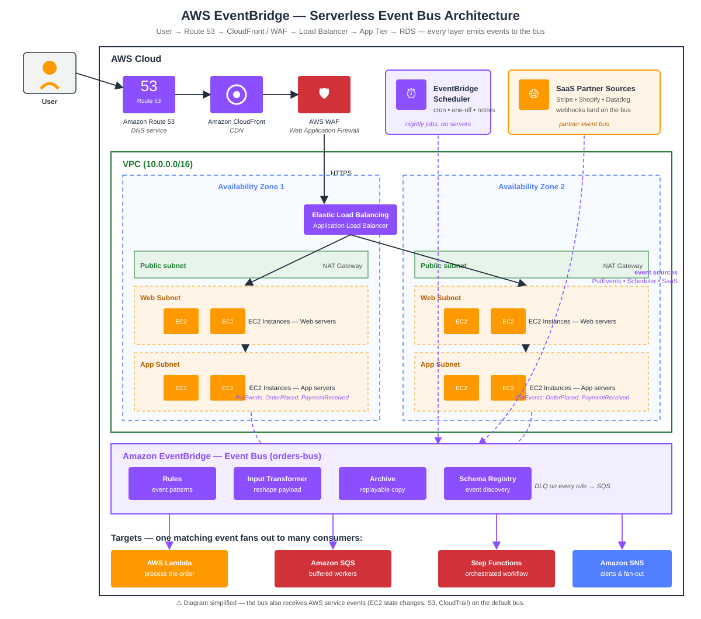

# AWS EventBridge Guide ⚡


> **TL;DR:** EventBridge is AWS's serverless event bus. Producers drop events onto a bus, rules filter them by pattern, and matching events are routed to targets — Lambda, SQS, Step Functions, SNS, Kinesis and more. No polling, no queues to manage, no coupling between services. Add Scheduler for cron, Pipes for enrichment, and archives for replay, and you have the nervous system of a modern event-driven architecture.

---

## Why EventBridge Matters

| Problem | Without EventBridge | With EventBridge |
|---|---|---|
| Service A must tell B, C and D something happened | Point-to-point calls, retries everywhere, A knows about everyone | A publishes one event; B, C, D subscribe independently |
| "Run this every night at 02:00" | A cron server you babysit | EventBridge Scheduler — serverless, timezone-aware, retries built in |
| "What happened before the bug?" | Guess from scattered logs | Archive + replay — re-deliver past events to a fixed consumer |
| Third-party webhooks (Stripe, Shopify, Zendesk) | Build a webhook receiver per vendor | SaaS partner event sources land straight on your bus |
| Cross-account events | Custom plumbing, shared queues | Event buses accept events from other accounts natively |
| Debugging event flow | Black box | Schema Registry + CloudWatch metrics per rule |

## How EventBridge Works

```
EVENT SOURCES (producers — anything can publish)
  • Your apps (PutEvents API)   • AWS services (~140 emit events natively)
  • SaaS partners (Stripe, Datadog, Zendesk…)  • EventBridge Scheduler (cron / one-off)
                              │
                              ▼
                 ┌─────────────────────┐
                 │   EVENT BUS         │  default bus, custom buses,
                 │   (filter + route)  │  partner buses, cross-account
                 └──────────┬──────────┘
                            │
              ┌─────────────┼─────────────┬──────────────┐
              ▼             ▼             ▼              ▼
           RULES — event patterns (JSON matching on source,
           detail-type, detail fields) + optional input transformers
              │             │             │              │
              ▼             ▼             ▼              ▼
   TARGETS: Lambda · SQS · Step Functions · SNS · Kinesis ·
            ECS task · API Destination (HTTP) · CodeBuild · …
```

An event is just JSON: `source`, `detail-type`, `detail`, plus `time`, `region` and `account`. Rules match on any field — exact values, prefixes, numeric ranges, `exists`, `anything-but`. A rule that matches nothing costs nothing.

## Architecture



**Traffic / event flow:** User → Route 53 → CloudFront / WAF → Application Load Balancer → EC2 app tier (private subnets across 2 AZs) → RDS. In parallel, every layer emits events: the app publishes order events with `PutEvents`, S3 emits object-created events, Scheduler fires nightly jobs, and SaaS partners (e.g. Stripe) deliver payment events. All of them land on the EventBridge bus, where rules route them to Lambda (process the order), SQS (buffered workers), Step Functions (orchestrated workflows) and SNS (alerts) — with archives keeping a replayable copy of everything.

## Core Concepts

### 1. Event Buses — one bus per boundary

| Bus type | Use it for |
|---|---|
| **Default bus** | AWS service events (EC2 state changes, S3, health events) — every account has one |
| **Custom bus** | Your own application events, one per domain (`orders`, `payments`, `users`) |
| **Partner bus** | SaaS events from a partner event source (Stripe, Shopify, Datadog) |
| **Cross-account** | A bus in account A accepts `PutEvents` from account B via a resource policy |

One bus per bounded context keeps rules small and blast radius contained. A single "god bus" turns into the same spaghetti EventBridge was meant to replace.

### 2. Rules — patterns, not code

```json
{
  "source": ["com.myapp.orders"],
  "detail-type": ["OrderPlaced"],
  "detail": {
    "total": [{ "numeric": [">=", 1000] }],
    "currency": ["USD", "EUR"],
    "customer": { "tier": ["premium"] }
  }
}
```

Matching is exact and structural: a rule matches when **every** field in the pattern matches. There is no OR inside one field list beyond the list itself, and no regex — use an **input transformer** to reshape the event before delivery, or a Lambda to do complex filtering.

### 3. Targets — what happens when a rule matches

| Target | Best for |
|---|---|
| **Lambda** | Real-time processing, fan-out to code |
| **SQS queue** | Buffering, retries, decoupling slow consumers |
| **Step Functions** | Multi-step workflows, sagas, human approval |
| **SNS topic** | Notifications, fan-out to email/SMS/HTTP |
| **Kinesis stream** | Streaming analytics, replayable consumers |
| **API Destination** | Call an external HTTP endpoint (with auth + rate limits) |
| **ECS task / CodeBuild** | Kick off batch jobs or builds from events |

One rule can have many targets, and a failed delivery retries for 24 hours by default — set a **dead-letter queue (DLQ)** on the rule so poison events land somewhere you can inspect instead of vanishing.

### 4. Scheduler — cron without servers

EventBridge Scheduler replaces the old "CloudWatch Events cron rule" pattern: one-time or recurring schedules, timezone-aware, flexible time windows (spread a 02:00 job across 02:00–02:15 to avoid thundering herds), built-in retry policy and DLQ. It can invoke 270+ AWS API actions directly — no Lambda middleman needed to start an ECS task or send an SNS message.

### 5. Pipes — glue with enrichment and filtering

Pipes connect a source (SQS, Kinesis, DynamoDB Streams, MSK, self-managed Kafka) to a target (Lambda, Step Functions, SQS, EventBridge bus, API Destination…) with optional **filtering** (only forward matching records) and **enrichment** (call a Lambda or API Destination to add data before delivery). Think of it as a tiny, managed ETL between two AWS services.

### 6. Archives & Replay — your time machine

Enable an **archive** on a bus and every event is stored (retention: 1 day to indefinite). Something went wrong? Create a **replay**: pick an archive, a time range and a destination bus, and EventBridge re-delivers those events. New consumer joining late, a bug fixed in a downstream service, a missed deploy — replay is the recovery path that polling architectures never have.

## Event Design — the part most teams get wrong

| Rule | Why |
|---|---|
| **Name events in past tense** — `OrderPlaced`, not `PlaceOrder` | An event is a fact about something that already happened |
| **Include a stable ID + timestamp in `detail`** | Idempotency: consumers dedupe on the ID, not on hope |
| **Keep `detail` self-contained** | Consumers should not have to call back to the producer for the basics |
| **Version your events** — `detail.version: 1` | Consumers can handle v1 and v2 side by side during rollout |
| **One event type, one meaning** | `OrderPlaced` with `total: 0` is a different fact from `OrderCancelled` — don't overload |
| **Don't put secrets or PII in events** | Events are logged, archived and replayed — treat them like logs |

## Cost Levers

- **Custom events:** ~$1.00 per million published (first 100k/month free-ish via free tier). AWS service events on the default bus are free to receive; you pay only for rules that match and invoke targets.
- **Scheduler:** ~$1.00 per million invocations — cheaper than a Lambda cron wrapper once you count the Lambda invocations it replaces.
- **Archives:** storage is cheap; set a retention that matches your replay window (30–90 days is usually plenty).
- **Watch the fan-out:** one event matching 10 rules that each invoke a Lambda is 10 Lambda bills. Keep rules tight and targets minimal.

## Checklist

- [ ] One custom bus per domain, not one god bus
- [ ] Every rule has a DLQ (SQS) so failed deliveries are visible
- [ ] Input transformers used where targets need a reshaped payload
- [ ] Archive enabled on production buses (30–90 day retention)
- [ ] Scheduler used instead of Lambda cron wrappers
- [ ] Events carry a stable ID + version for idempotency
- [ ] CloudWatch alarms on `FailedInvocations` per rule
- [ ] Schema Registry enabled so consumers discover event shapes

## Try It

```bash
# Offline demo — no AWS account needed
python eventbridge_demo.py --demo

# Live (needs AWS credentials + boto3)
python eventbridge_demo.py --live --bus orders-bus --region ap-southeast-1
```

## Quiz

Test yourself in [quiz.md](quiz.md) — 5 questions on buses, rules, Scheduler, Pipes and replay.

---

*Last updated: 13 November 2026*
